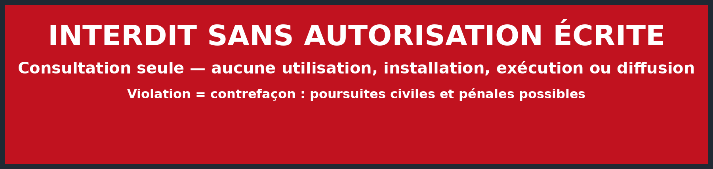

# Plugin-GreenIT-RNCP — bundle GreenIT RNCP39388

<p align="center"></p>

<h2 align="center" style="color:#C1121F">CONSULTATION SEULE — UTILISATION INTERDITE</h2>


**Créateur : ZiRaOmega.**

Bundle reproductible pour produire des livrables GreenIT et des preuves pour le titre **RNCP39388 — Responsable green IT** (niveau 6, Efficom, 4 blocs, 19 compétences).

Il contient quatre plugins :

- **greenit-studio** : rapports DOCX/PDF, diaporamas PPTX/PDF, vidéos MP4, figures PNG, analyse de codebase.
- **greenit-audit** : RGESN 2024 (78 critères), GR491, RWEB, ACV ISO 14040/44, GWP/ADPe/ADPf, EcoIndex, SCI, rapport, soutenance, dossier RNCP39388.
- **greenit-engineering** : refactor, fix, proposition, brainstorm, benchmark, revue de code GreenIT.
- **greenit-reviewer** : revue indépendante design/PDF/PPTX, caractères IA, glossaire, données, graphiques et blocs RNCP39388.

`greenit-audit` dépend de `greenit-studio`, `greenit-engineering` et `greenit-reviewer`. Les autres plugins sont autonomes.

## Prérequis

- Python 3.10+
- `uv` (recommandé) ou `pip`
- LibreOffice (`soffice`) pour les PDF
- `ffmpeg` et `ffprobe` pour la vidéo
- `pdftoppm`, `pdfinfo`, `pdftotext` (poppler-utils)
- Chromium ou Google Chrome pour Playwright
- Claude Code 2.1+ pour installer le marketplace

## Installation

```bash
cd greenit-rncp39388
uv sync
make validate
make test
```

Pour installer le marketplace dans Claude Code :

```text
/plugin marketplace add <owner>/<repo>
/plugin install greenit-audit --marketplace <owner>/<repo>
```

Remplacer `<owner>/<repo>` par le dépôt qui héberge `.claude-plugin/marketplace.json`.

Guide multi-harness : `INSTALL.md`. Guide Claude Code : `shared/docs/13-CLAUDE-CODE.md`.

## Démonstration

La démo complète nécessite `factors.local.csv`, non inclus pour raisons de licence. Voir `INSTALL.md` et `plugins/greenit-audit/references/factors.local.example.md`.

```bash
make demo
make check
```

`make demo` produit dans `dist/` :

- `rapport-audit-greenit-demo.docx` et `.pdf` (19 sections, 5 figures, 15 tableaux) ;
- `soutenance-greenit-demo.pptx` et `.pdf` (15 slides, notes de 1800–2200 mots) ;
- `teaser-greenit-demo.mp4` (75 s, 1920×1080, H.264) ;
- `synthese-client-greenit-demo.docx` et `.pdf` (synthèse autonome de 4 pages) ;
- `notes-orales-demo.md`, `figures/`, `audit-demo/` (dont `hypotheses.csv`), `rncp39388/`, `manifest.json`.

`make check` vérifie les tailles, pages, slides, durée, sources, hypothèses, 78 critères RGESN, 19 compétences RNCP, la synthèse client et l’absence de placeholders.

## Utilisation sur un audit réel

1. Copier `plugins/greenit-audit/assets/example-audit.yml` vers `audit.yml`.
2. Remplacer le projet, l’unité fonctionnelle, les scénarios, l’inventaire et les hypothèses.
3. Valider et calculer :

```bash
cp plugins/greenit-audit/references/factors.local.example.csv \
   plugins/greenit-audit/references/factors.local.csv
# remplir factors.local.csv avec des facteurs sous licence

python3 plugins/greenit-audit/scripts/validate_audit.py --input audit.yml \
  --factors plugins/greenit-audit/references/factors.open.csv \
  --factors plugins/greenit-audit/references/factors.local.csv

python3 plugins/greenit-audit/scripts/calc.py --input audit.yml \
  --factors plugins/greenit-audit/references/factors.open.csv \
  --factors plugins/greenit-audit/references/factors.local.csv \
  --out dist/audit-demo/metrics.json --markdown
```

4. Évaluer les 78 critères dans `rgesn-assessment.yml`, puis lancer `score_rgesn.py`.
5. Générer le rapport, le deck et le dossier RNCP avec les skills `/greenit-audit:*`.

## Structure

```text
.claude-plugin/marketplace.json
plugins/
  greenit-studio/      # 5 skills, scripts DOCX/PPTX/vidéo/figures/scanner
  greenit-audit/       # 7 skills, références, calculs, schémas
  greenit-engineering/ # 6 skills, playbooks, mesure de delta
  greenit-reviewer/    # 4 skills + agent indépendant de revue design/qualité
shared/
  docs/                # architecture, sources, glossaire, calculs, RNCP, style, limites
  schemas/             # audit, deck, source
  templates/           # plan projet, RACI, risques, charte, formation, rétrospective
  examples/            # audit, deck et rapport d’exemple
examples/demo-service/ # service d’émargement perfectible
scripts/               # démo, optimisation, contrôles
tests/                 # unitaires + e2e optionnel
dist/                  # généré
```

## Calculs

Le moteur utilisé est `calc.py`. Il calcule :

- `GWP100` en kg CO2e ;
- `ADPe` en kg Sb eq ;
- `ADPf` en MJ.

Les formules et les pièges sont dans `shared/docs/03-CALCULATIONS.md`. Les facteurs ouverts sont dans `factors.open.csv`. La démonstration utilise `factors.local.csv` (non versionné) pour couvrir GWP, ADPe et ADPf réseau. `factors.local.example.csv` ne contient que l’en-tête : aucune valeur NegaOctet n’est publiée. Le facteur ouvert Green Coding reste disponible dans `factors.open.csv` comme variante de screening pour le GWP seul.

Le rapport distingue **mesuré**, **estimé**, **supposé** et affiche une fourchette d’incertitude. Il sépare aussi les **statuts** (100 % des critères applicables) et les **preuves** (39,6 %) : le score de 15/100 est donc non significatif, même si aucun critère n’est laissé sans statut.

## Sources

42 sources sont registrées dans `plugins/greenit-audit/references/sources.yml` : RNCP39388, RGESN 2024, GR491, RWEB, ADEME, ISO, PEF, ITU-T, loi REEN, CSRD, RGPD, RGAA, Boavizta, EcoIndex, Green Coding, NegaOctet, OWASP, ANSSI, GHG Protocol, supports locaux Zone01.

Les liens et dates sont indiqués. Les normes ISO sont payantes et ne sont pas reproduites. Les valeurs NegaOctet ne sont pas publiées. `factors.local.example.csv` est un en-tête vide ; fournir `factors.local.csv` sous licence pour un usage local. Les supports Zone01 sont cités comme sources pédagogiques locales.

## RNCP39388

Le dossier `dist/rncp39388/` contient :

- `01-matrice-competences.csv` : 19 lignes, 4 blocs ;
- `02-dossier-preuves.md` : preuves par compétence ;
- `03-checklist-livrables.md` ;
- `04-questions-jury.md` : 40 questions ;
- `05-plan-soutenance-15min.md` ;
- `06-charte-numerique-responsable.md` ;
- `07-plan-mesure-energetique.md` ;
- `08-plan-projet.md` ;
- `09-formation-greenit.md` : 10 slides, quiz, exercice ;
- `10-retrospective.md`.

RNCP42198 est un autre titre « Responsable green IT » (niveau 7, IPSA). Il n’est pas utilisé.

## Limites

Le bundle produit une **ACV screening** et un **score d’avancement RGESN**, pas une ACV avec revue critique, pas un audit RGESN officiel, pas un bilan GES réglementaire, pas un conseil juridique. Les données manquantes sont signalées. Les effets rebond et les impacts sociaux ne sont pas mesurés.

## Avertissement légal

**Ce dépôt n’est pas open source.** La licence `View-Only License 1.0 (No Use)` autorise uniquement la consultation du code et de la documentation. Toute utilisation, installation, exécution, copie, modification, distribution, mise en service ou création dérivée est interdite sans autorisation écrite de **ZiRaOmega**.

### Conséquences possibles en cas de non-respect

- **Civil** : action en contrefaçon, demande de cessation, retrait du dépôt ou du service, dommages-intérêts, remboursement des frais juridiques, saisie-contrefaçon et mesures d’interdiction.
- **Pénal** : en France, la contrefaçon de droits d’auteur est notamment punie par l’article L335-2 du Code de la propriété intellectuelle de **trois ans d’emprisonnement et 300 000 € d’amende**, sous réserve de l’appréciation des tribunaux et des exceptions légales. D’autres juridictions prévoient leurs propres peines.
- **Plateforme** : signalement pour atteinte au droit d’auteur, retrait du dépôt ou du fork, suspension de compte selon les règles de l’hébergeur.
- **Tiers** : les titulaires de contenus tiers, notamment les facteurs sous licence, peuvent également agir.
- **Instructions d’installation** : leur présence ne vaut pas autorisation. Elles sont documentaires et réservées au titulaire et aux collaborateurs autorisés.

**Consultation autorisée. Utilisation interdite.** Ce texte n’est pas un conseil juridique personnalisé ; consultez un avocat pour votre situation.

## Licence

Code original : **View-Only License 1.0 (No Use)**. Consultation autorisée ; toute utilisation, installation, exécution, copie, modification ou diffusion est interdite sans autorisation écrite de ZiRaOmega. Les contenus tiers gardent leur licence. Voir `LICENSE` et `THIRD_PARTY_NOTICES.md`.
